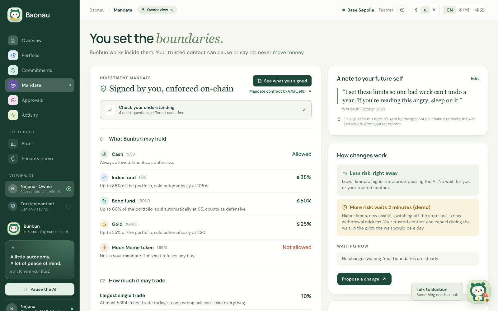
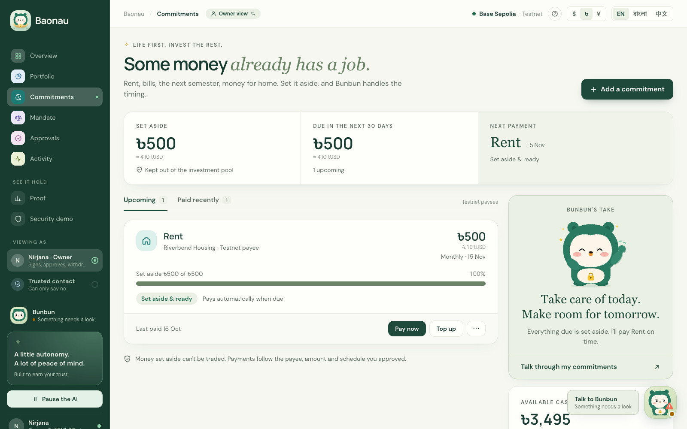
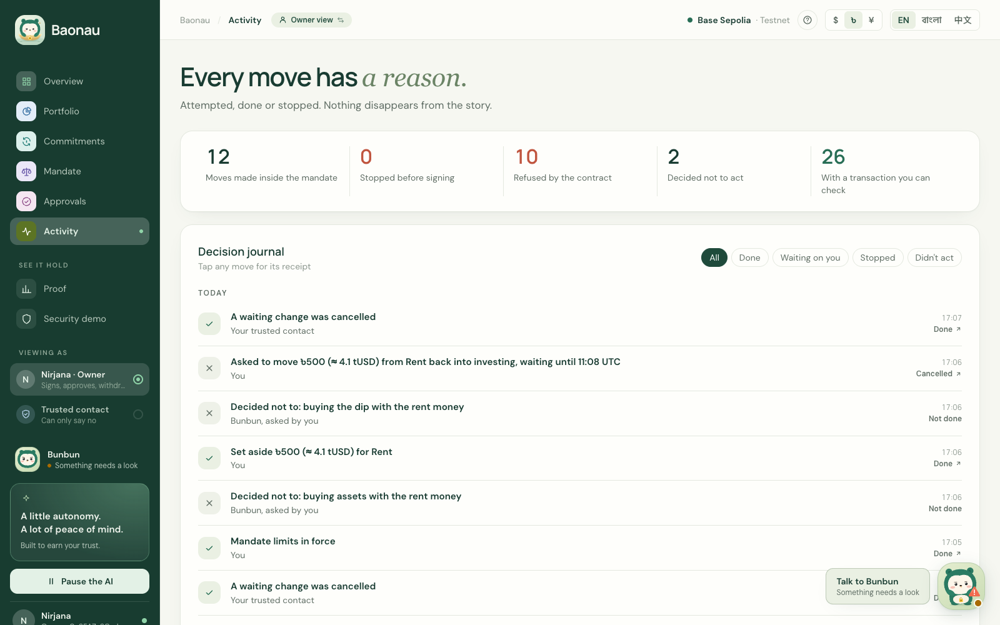
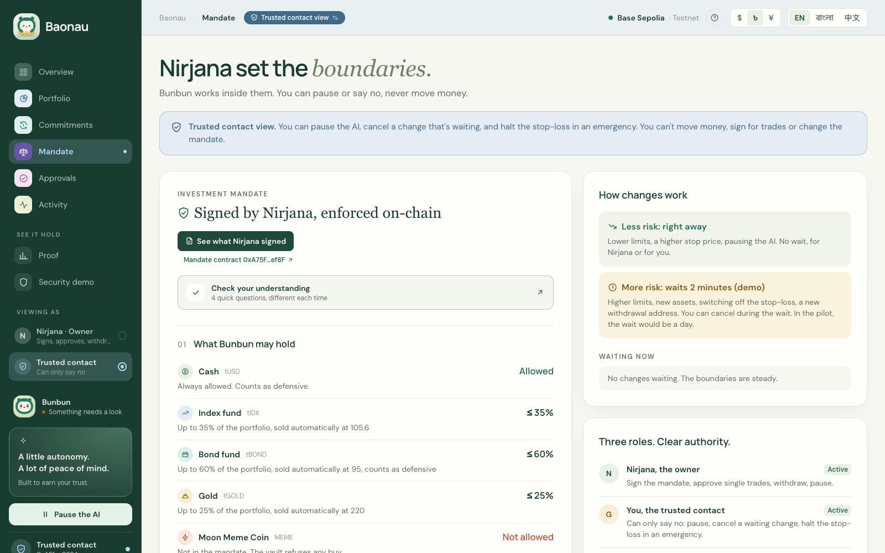
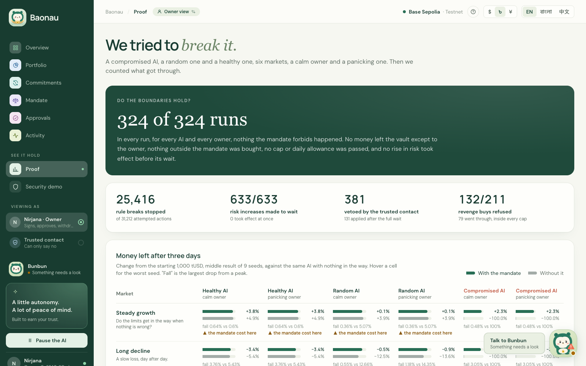

# Baonau

**An AI that invests for you, inside rules it can't break. Even on your bad days.**

Team Ulysses · 2026 Shenzhen International FinTech Competition, International Track · Topic F (Agent Wallet)

> Everything here runs on test networks with simulated test assets. Nothing has real value or real backing.

*Baonau* is 宝 (bǎo, treasure, in Chinese) and নাও (nau, boat, in Bangla): a boat that carries something precious. The AI inside it is Bunbun.

## Why we built this

We're students, and some of us already earn a little. After rent and bills there's money left over, and no plan for it. A fixed deposit feels like the only option, and investing feels like something you need to be an expert in first. Friends at universities in Dhaka, Chittagong and Rajshahi told us the same thing: they want to start, but don't know where, or how to keep the risk down. People who work around the Dhaka Stock Exchange and at banks told us the other half: starting isn't the hard part. Sticking to the plan when the market drops is.

And people our age are already asking AI about money. In a UK survey this August, 4 in 5 less experienced investors said they'd used AI for help with investing, and 38% said it's fine to decide based only on what an AI says ([FCA, 27 Aug 2026](https://www.fca.org.uk/news/press-releases/young-investors-trust-ai-more-tv-or-celebrities)).

So we asked: what if an AI could invest on a schedule and pay your bills for you, but only inside rules you set? Rules it can't break, and that you can't quietly break on a bad day either.

## What it feels like

1. **You say your goal in your own words and language: English, 中文 or বাংলা, and you can switch any time.** In our demo it's Bangla: "আমার কাছে ৳৫,০০০ আছে। আমি দীর্ঘমেয়াদি বৃদ্ধি চাই, কিন্তু বেশি ঝুঁকি নিতে চাই না।" (I have ৳5,000. I want long-term growth, but not much risk.)
2. **Bunbun drafts your investment mandate.** Which assets, how much of each, how big a trade can be, how much you can lose in a day before buying stops, where the stop-losses sit. In plain language.
3. **You check you understand it, write a note to your future self, and sign.** The rules go on-chain.
4. **Bunbun does the everyday work.** Rebalancing, a small buy every week, paying your rent on time from money you set aside for it. Every action, and every refusal, gets a receipt listing each rule it was checked against.
5. **Some money already has a job.** Rent, bills, tuition, money sent home. You set it aside as a commitment, it leaves the portfolio, and it only ever goes to the payee you approved, on the schedule you approved.

<table>
<tr>
<td width="50%"><br><sub>The mandate the user signed, in plain language, with their note to their future self</sub></td>
<td width="50%"><br><sub>Rent set aside, paid on time to the payee the user approved</sub></td>
</tr>
<tr>
<td width="50%"><br><sub>A receipt for every move, including the ones that were stopped or cancelled</sub></td>
<td width="50%"><br><sub>The trusted contact's view: they can pause or say no, never move money</sub></td>
</tr>
</table>

## The one rule

We designed for two things going wrong:

- **The AI goes wrong.** It misreads something, gets tricked by a poisoned news story, or its key gets stolen.
- **You go wrong.** After a loss, you want to win it back, and the first thing you remove is your own protection.

So: **less risk takes effect now. More risk has to wait**, and someone you trust can cancel it during the wait.

| Applies right away | Waits, and your trusted contact can cancel |
|---|---|
| Lowering a limit, raising a stop price, pausing the AI | Raising a limit, adding an asset, switching off the stop-loss, a new withdrawal address, a new payee, moving rent money back into investing |

You can always take your money out, instantly, to your own address. We add friction to risk, never custody.

The idea is old. Ulysses had himself tied to the mast before he heard the sirens. Economists call it a commitment device. That's where our team name comes from.

## Does it hold?

We tried hard to break it.

- **Live on the public testnet (16 Oct 2026).** We ran the whole story on Base Sepolia with DeepSeek as the agent: a goal typed in Bangla, signing, rent paid on time, a hacked-agent attack (10 attempts, all 10 refused by the contract, nothing sent out), a crash with the stop-loss firing, and "triple my loss limit" being queued and cancelled by the trusted contact. All 33 transactions, with explorer links: [`docs/evidence/`](docs/evidence/README.md). We recorded the demo video the next day on another fresh vault, so every scene in it is a real transaction too (30 more, same file).
- **324 stress runs.** 6 markets (steady growth to a crash to a manipulated price feed) × 3 agents (healthy, random, hacked) × 2 owners (calm, panicking) × 9 seeds, on the real contracts. The bounds held in every run. 25,416 rule-breaking actions were stopped, and all 633 attempts to loosen the rules had to wait. Without the mandate, every hacked-agent run ended at zero; with it, the worst run kept 94%. It's not free: in steady growth the mandate earned 3.8% against 4.9% without it. In a crash, the median fall was 5.0% instead of 11.4%.
- **16 attacks against real models.** Hidden instructions in news (English and Bangla), scam token promotions, fake invoices, fake rent notices, "use my rent money to buy the dip" and more. A plain agent on a small model (Llama 3.2 3B) was beaten 30 times out of 48. Ours: 0 out of 48, on both DeepSeek and Llama. With no model at all, just the agent's key, the contract still refused 23 of 23 attacker goals.
- **187 contract tests**, 21 invariants, about a million random calls, 0 violations.



What we don't claim: a hacked agent can still make bad trades *inside* the limits, the price feed is a mock, and none of this has had an outside audit. The full list is in the [security self-assessment](docs/security-self-assessment.md).

## How it's built

```
your words / news / invoices ──▶ quarantined reader (a model with no tools; typed fields only)
                                        │
                                        ▼
                                  Bunbun, the agent (DeepSeek; proposes tool calls only)
                                        │
                                        ▼
                                  risk engine (plain code; checks every rule, writes the receipt)
                                        │
                                        ▼
                                  PolicyVault + Mandate (Solidity; enforces every limit on-chain)
                                        ▲
          you (sign, approve one exact trade) · trusted contact (pause, cancel) · keeper (prices, stop-loss)
```

- **Contracts** (`contracts/src/`): `Mandate.sol` holds every rule and decides which changes apply now and which wait (the table at the top of the file is the spec). `PolicyVault.sol` holds the assets and checks the mandate on every trade. `VaultFactory.sol` makes new vaults as clones. Solidity 0.8.11, so the same contracts also run unchanged on WeBank's FISCO BCOS.
- **App** (`app/`): TypeScript, Next.js and viem. The agent runs on DeepSeek through an OpenAI-compatible API, so the model can be swapped. English, Bangla and Chinese throughout.

The full design, the algorithms and every number are in the [technical documentation](docs/technical-documentation.md).

## Try it

### Just want to see it?

Watch the demo video: **[VIDEO LINK]**. It shows the whole story on the public testnet: a goal typed in Bangla, signing, rent paid on time, the hacked-agent attack, a crash, and a risk increase cancelled by the trusted contact. The screenshots near the top of this page show the main screens.

### Run it on your own computer

This runs everything on your own computer: a private practice blockchain, our contracts and the app. No real money is involved, and nothing goes to a public network.

**What you need**

| | |
|---|---|
| A Mac or Linux computer | On Windows, install [WSL](https://learn.microsoft.com/windows/wsl/install) first and do every step below inside its Ubuntu terminal. The demo won't run in the normal Windows Command Prompt or PowerShell. |
| Git | Already on most Macs (type `git --version`; if it's missing, your Mac offers to install it). On Linux or WSL: `sudo apt install git`. |
| Node.js 24 | From [nodejs.org](https://nodejs.org), version 24. To check, type `node -v`: it should print `v24` and some more numbers. |
| Foundry | Type `curl -L https://foundry.paradigm.xyz \| bash`, open a new terminal window, then type `foundryup`. To check, type `anvil --version`. |
| About 10 minutes | Installing takes a few minutes; after that the demo starts in about one. |

**Steps**, typed in a terminal:

1. Download the project and install what the app needs. Please use this command rather than GitHub's "Download ZIP" button: the ZIP leaves out two libraries the contracts need.

   ```bash
   git clone --recurse-submodules https://github.com/fariha-nirjana/baonau
   cd baonau/app
   npm install
   ```

2. Start the demo:

   ```bash
   npm run demo -- --signed
   ```

3. When the terminal shows `Open: http://localhost:3002`, open that address in your browser.
4. Leave the terminal window open while you use the app. Press Ctrl+C in it to stop everything. Every run starts fresh.

`--signed` starts with a sample mandate already signed by our demo investor, Nirjana, so you land straight on the dashboard and the app greets you by that name. Use it if you don't have an AI key (see below). In the full setup, the app uses the name you type.

**What works without an AI key**

Everything except talking to Bunbun:

- the dashboard, portfolio, mandate, commitments, approvals and the receipts in Activity
- the **Security demo**: a scripted attacker uses Bunbun's real key, every attempt is sent to the chain, and you see the contract refuse them (an attempt that stays inside the mandate's limits can go through, and the screen says so)
- the **Proof** screen, with the stress-run and red-team results
- the trusted contact's view (switch to it in the sidebar), the currency (৳, $, ¥) and the language (English, বাংলা, 中文)

**To chat with Bunbun, or to do the first-time setup**

Chatting with Bunbun, and the first-time setup where Bunbun writes the mandate from your goal, need an AI model. We use DeepSeek:

1. Make an account at [platform.deepseek.com](https://platform.deepseek.com), add a small amount of credit, and create an API key. It starts with `sk-`.
2. Start the demo with your key, and without `--signed`:

   ```bash
   LLM_API_KEY=sk-your-key npm run demo
   ```

   The app now opens on the first-time setup. Your key stays on your computer and is only used by the app running there. Any other OpenAI-compatible provider works too: also set `LLM_BASE_URL` and `LLM_MODEL`.

**If something doesn't work**

| What you see | Why, and what to do |
|---|---|
| Bunbun says "I could not think this through just now" | There's no AI key, or it's wrong or out of credit. Bunbun does nothing rather than guess. Restart with `npm run demo -- --signed`, or add a key as above. |
| The setup is stuck on "What would you like your money to do?" | The same reason: Bunbun needs the AI key to write the mandate. Restart with `--signed`, or add a key. |
| `Foundry missing` | Install Foundry (see "What you need"), then open a new terminal window so it's found. |
| `Deploy failed` | Usually the contract libraries are missing because the project came from a ZIP. Download it with the `git clone --recurse-submodules` command above. |
| `Port 8552 is in use` or `Port 3002 is in use` | An earlier demo is still running. Close that terminal window, or type the command the message shows. |
| `command not found` on Windows | Use the WSL Ubuntu terminal (see "What you need"). |
| Errors during `npm install` | Check that `node -v` shows version 24. |
| It seems stuck at "Building the app" | The first build takes about a minute. |

<details>
<summary>Full setup on Base Sepolia</summary>

You need Node 24, Foundry (tested with 1.8.5), a Base Sepolia RPC (the public one works) and an OpenAI-compatible model API key (we use DeepSeek).

```bash
git clone --recurse-submodules https://github.com/fariha-nirjana/baonau
cd baonau
scripts/new-env.sh          # fresh testnet keys into .env (or copy .env.example)
# fund the owner, agent, guardian and oracle updater addresses from a Base Sepolia faucet
# add LLM_API_KEY to .env

cd contracts
forge test
forge script script/Deploy.s.sol --rpc-url $RPC_URL --broadcast
# copy the printed addresses into .env

cd ../app
npm install
npm test
npm run dev                 # http://localhost:3000
```

Handy scripts, all from `app/`:

| Command | What it does |
|---|---|
| `npm run ask -- "message"` | Send one message to Bunbun and print every tool call and receipt |
| `npm run attack` | Run the hacked-agent playbook with the real agent key (every call should revert) |
| `npm run keeper` | Refresh prices and fire any stop-loss that's due |
| `npm run autopilot` | The scheduled check: recurring buys, rebalancing, bills that are due |
| `npm run owner -- requests` | Owner and trusted contact actions from the terminal |
| `npm run harness` | The 324 stress runs on a local chain |
| `npm run redteam` | The red-team suite (`--dry` for the contract column only, no model calls) |

</details>

## Tests

- `contracts/`: `forge test` (187 tests). `FOUNDRY_PROFILE=deep forge test` for the long run.
- `app/`: `npm test` (68 tests), `npm run typecheck`, `npm run lint`.
- `app/harness/` and `app/redteam/`: the stress runs and attacks above. Results are committed under `results/`.

## Deployments

Base Sepolia (chain 84532), deployed 15 Oct 2026. Every contract is verified on Sourcify. Vaults and mandates are 45-byte EIP-1167 clones of the verified templates, so they have no source of their own to verify.

| Contract | Address |
|---|---|
| Vault (demo-video recording, 17 Oct) | `0xC3Da7a268e4B373093D1e3A6f0789CE8e5fac08d` |
| Mandate (demo-video recording, 17 Oct) | `0x6d4C768bFCCEC456fCe81E812078F422e47c172C` |
| Vault (live run, 16 Oct) | `0x4F39604cdF8078a48a20DFFc39d79b3551ea7D6F` |
| Mandate (live run, 16 Oct) | `0xA75F62d72e9c5Ddf303A7Bd4d1A8899FEb2cef8F` |
| Vault (first, 15 Oct) | `0x213F465d03C3E008cE6f4562D92Ed90e3F6c0B21` |
| Mandate (first, 15 Oct) | `0x1C344fB4C23Aa939D8f917E2e6095Fced975B42a` |
| Factory | `0x45170Cf431e66A495C513FE9412512b335a56106` |
| Mandate template | `0x29eC0050152Fe913092BD45e93aa5bE4Aea2A38D` |
| Vault template | `0x762155474Fec6aE0A734bc4A4518ac8f7661d827` |
| tUSD | `0xD1D79F4946BaDc69B492c3316a8cEA543e16bb99` |
| Price oracle (mock) | `0xf91fdB1e0eB25C2A3b1DC5FE233Ab169079Bc9C1` |
| Exchange (mock) | `0x570aa6d177862c17A0F06905681C7908Ae241299` |
| tIDX / tBOND / tGOLD / MEME | `0x8a7206F9943CA413045b9fa11c20cc9AA203cEA5` / `0x0971e818fF02C76bE10876ED3AF9CD6Ed226AFE5` / `0x1f0297097138649ff965e1932a544Fc1b38887c5` / `0x1a95281b9AfE38a1275891b5307ee0E437A9048A` |

**FISCO BCOS.** The same contracts, unchanged, also run on a local one-node FISCO BCOS 3.16 chain (`scripts/fisco-chain.sh` builds it). Trades, the hacked agent's calls, an owner-signed approval, a queued change with a veto and a bill payment all behave the same there. That chain is local, so its hashes aren't public; the Base Sepolia ones are.

## Compliance note

This is a guardrail design for AI agents on regulated rails, shown on test networks with simulated test assets. It isn't a crypto product or a tokenization service, and we make no claim that it could be offered in any particular country.

## License

MIT. See [LICENSE](LICENSE).
